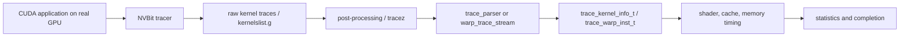

# Trace pipeline

## Current evidence

The intended path is:

Source evidence for producer structs and Hopper cluster/TMA fields is in
`util/tracer_nvbit/tracer_tool/{common.h,tracer_tool.cu,tracez_format.h}`;
consumer evidence is in `gpu-simulator/{trace-parser,trace-driven}`.

The verified simulator-side path is:

`gpu-simulator/main.cc`
→ `accel_sim_framework::simulation_loop()`
→ `parse_commandlist()`
→ `trace_parser::parse_kernel_info()` / `create_kernel_info()`
→ `trace_gpgpu_sim::launch()`
→ `gpgpu_sim::cycle()`
→ `trace_shader_core_ctx::get_next_inst()`
→ scheduler `issue_warp()`
→ ordinary shader/cache/interconnect/memory timing. For memory instructions,
`simt_core_cluster::icnt_inject_request_packet()` calls `icnt_push`, and
`gpgpu_sim::cycle()` calls `icnt_pop`/`icnt_transfer` in the configured clock
domain.

## A800 vectoradd smoke test (2026-09-19)

Evidence: `Verified` for the software pipeline on one NVIDIA A800; this is not
Hopper/NVLink/NVSwitch/NVLS validation.

- NVBit 1.8 is installed under the `in-switch` conda environment at
  `/home/wangjz/miniconda3/envs/in-switch/opt/nvbit-1.8`.
- Build: `make -C util/tracer_nvbit NVBIT_PATH=$CONDA_PREFIX/opt/nvbit-1.8/core`.
- Workload: SDK `test-apps/vectoradd/vectoradd.cu`, compiled for `sm_80`.
  The CUDA result was `Final sum = 100000.000000; sum/n = 1.000000`.
- Trace: `CUDA_VISIBLE_DEVICES=0`, a temporary `TRACES_FOLDER`,
  `CUDA_INJECTION64_PATH=util/tracer_nvbit/tracer_tool/tracer_tool.so`, and
  `SPINLOCK_HANDLING_MODE=0`.
- Artifacts: one raw compressed trace (271,492 bytes), one `.tracez`
  (1,083,875 bytes), `kernelslist.g` (146 bytes), and one kernel with 98 CTAs,
  1,024 threads/CTA, and 50,066 reported instructions.
- Replay: release `accel-sim.out` with the SM80 A100 configuration and trace
  latency options. Exit 0; 6,824 simulated cycles, 1,502,112 simulated
  instructions, 98 issued CTAs, 75,000 request packets, 75,000 reply packets,
  and about 16 seconds CPU simulation time.

The producer-to-disk and replay path is now verified on a real A800 artifact.
A source-level single-instruction autopsy remains a separate task, and the
trace contains no proof of multi-GPU communication semantics.
