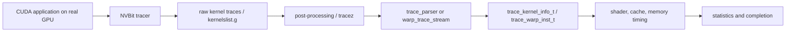

# Trace pipeline

## Current evidence

The intended path is:

Source evidence for producer structs and Hopper cluster/TMA fields is in
`util/tracer_nvbit/tracer_tool/{common.h,tracer_tool.cu,tracez_format.h}`;
consumer evidence is in `gpu-simulator/{trace-parser,trace-driven}`.

## Reproduction status

No new A800 trace was generated in this phase: the NVBit binary/SDK was not
present and the only GPU was busy. The next run must use a tiny benchmark and
record every command and artifact. A real-instruction autopsy is still open.
