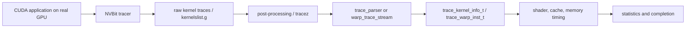
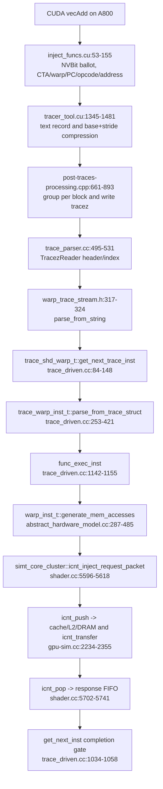

# Trace pipeline

## 当前证据

预期路径如下：



producer struct 与 Hopper cluster/TMA fields 的 source evidence 位于
`util/tracer_nvbit/tracer_tool/{common.h,tracer_tool.cu,tracez_format.h}`;
consumer evidence 位于 `gpu-simulator/{trace-parser,trace-driven}`。

已验证的 simulator-side path 为：

`gpu-simulator/main.cc`
→ `accel_sim_framework::simulation_loop()`
→ `parse_commandlist()`
→ `trace_parser::parse_kernel_info()` / `create_kernel_info()`
→ `trace_gpgpu_sim::launch()`
→ `gpgpu_sim::cycle()`
→ `trace_shader_core_ctx::get_next_inst()`
→ scheduler `issue_warp()`
→ 普通 shader/cache/interconnect/memory timing。对于 memory instruction，
`simt_core_cluster::icnt_inject_request_packet()` 会调用 `icnt_push`，而
`gpgpu_sim::cycle()` 会在配置的 clock domain 中调用 `icnt_pop`/`icnt_transfer`。

## A800 vectoradd smoke test（2026-09-19）

Evidence：单张 NVIDIA A800 上的 software pipeline 为 `Verified`；这不是
Hopper/NVLink/NVSwitch/NVLS validation。

- NVBit 1.8 is installed under the `in-switch` conda environment at
  `/home/wangjz/miniconda3/envs/in-switch/opt/nvbit-1.8`. This SDK directory is
  outside the Accel-Sim Git repository; therefore `vectoradd.cu` cannot be found
  by searching this repository. The exact source file used was:
  `/home/wangjz/miniconda3/envs/in-switch/opt/nvbit-1.8/test-apps/vectoradd/vectoradd.cu`
  (portable form: `$CONDA_PREFIX/opt/nvbit-1.8/test-apps/vectoradd/vectoradd.cu`).
- Workload Makefile: `$CONDA_PREFIX/opt/nvbit-1.8/test-apps/vectoradd/Makefile`.
  Its default `ARCH=sm_70` was overridden for this A800 run; the resulting
  executable contained `sm_80` cubins. This is an NVBit SDK sample, not an
  Accel-Sim benchmark and not a workload committed under `util/`.
- Tracer build: `make -C util/tracer_nvbit/tracer_tool
  NVBIT_PATH=$CONDA_PREFIX/opt/nvbit-1.8/core ARCH=sm_80`. The repository
  Makefile accepts `NVBIT_PATH` specifically so the SDK remains in the conda
  environment instead of being copied into the repository.
  The CUDA result was `Final sum = 100000.000000; sum/n = 1.000000`.
- Trace: `CUDA_VISIBLE_DEVICES=0`, a temporary `TRACES_FOLDER`,
  `CUDA_INJECTION64_PATH=util/tracer_nvbit/tracer_tool/tracer_tool.so`, and
  `SPINLOCK_HANDLING_MODE=0`.
- The run's generated executable was copied to
  `/tmp/in-switch-a800-trace-20260919/vectoradd`. The trace directory was
  `/tmp/in-switch-a800-trace-20260919/traces`. These are temporary artifacts,
  not repository files and are intentionally not committed.
- Artifacts: one raw compressed trace (271,492 bytes), one `.tracez`
  (1,083,875 bytes), `kernelslist.g` (146 bytes), and one kernel with 98 CTAs,
  1,024 threads/CTA, and 50,066 reported instructions.
- Replay: the release `accel-sim.out` with the SM80 A100 configuration and trace
  latency options was run against the generated `kernelslist.g`. The exact
  shell command used for this historical run was not saved as a repository
  artifact; this is an `Observed` limitation of the 2026-09-19 experiment.
  A future run must save the generated `run.sh`, replay command, and simulator
  configuration together with its metadata. The recorded replay exited 0;
  6,824 simulated cycles, 1,502,112 simulated
  instructions, 98 issued CTAs, 75,000 request packets, 75,000 reply packets,
  and about 16 seconds CPU simulation time.

### Reproduction recipe for a new run

The following commands make the external workload location explicit. They are
a reproducible recipe, not a claim that the historical run preserved every
shell line verbatim:

```bash
conda activate in-switch
export REPO=/home/wangjz/in-switch/accel-sim-framework
export NVBIT_ROOT="$CONDA_PREFIX/opt/nvbit-1.8"
export RUN=/tmp/in-switch-a800-trace-$(date +%Y%m%d-%H%M%S)

make -C "$NVBIT_ROOT/test-apps/vectoradd" clean
make -C "$NVBIT_ROOT/test-apps/vectoradd" ARCH=sm_80
make -C "$REPO/util/tracer_nvbit/tracer_tool" \
  NVBIT_PATH="$NVBIT_ROOT/core" ARCH=sm_80

mkdir -p "$RUN/traces"
cp "$NVBIT_ROOT/test-apps/vectoradd/vectoradd" "$RUN/vectoradd"
cd "$RUN"
export CUDA_VISIBLE_DEVICES=0
export TRACES_FOLDER="$RUN"
export SPINLOCK_HANDLING_MODE=0
export CUDA_INJECTION64_PATH="$REPO/util/tracer_nvbit/tracer_tool/tracer_tool.so"
./vectoradd

"$REPO/util/tracer_nvbit/tracer_tool/traces-processing/post-traces-processing" \
  "$RUN/traces"
```

The post-processor consumes the raw files in `$RUN/traces` and creates the
`.tracez` and `kernelslist.g` files used by the replay step. For a complete
replay record, copy the final simulator command and the selected SM80 config
into a small experiment metadata file; do not commit the raw trace.

The producer-to-disk and replay path is now verified on a real A800 artifact.
The trace contains no proof of multi-GPU communication semantics.

## One real instruction: `LDG.E.64` autopsy

Evidence level: `Verified` for the A800 artifact and the current checkout.
The following record is an actual line from
`/tmp/in-switch-a800-trace-20260919/traces/kernel-1-ctx_0x55fde6cbb7c0.trace.xz`:

```text
48 0 0 17 0 0 0 0 0 0 0 00a0 ffffffff 1 R4 LDG.E.64 1 R4 8 1 0x7f7490524700 8 0 0 0 NoVal
```

The kernel header says `binary version = 80`, `grid dim = (98,1,1)`,
`block dim = (1024,1,1)`, `cuda stream id = 0`, and `enable lineinfo = 0`.
The first eleven decimal fields in this trace-version-6 record are CTA x/y/z,
thread-block warp id, cluster id x/y/z, cluster CTA id x/y/z, and cluster rank.
Thus this instruction is CTA `(48,0,0)`, warp `17`, with pre-SM90 cluster
fields all zero. `00a0` is the virtual PC, `ffffffff` is the intersection of
the active and predicate masks (all 32 lanes), `R4` is the destination, and
`LDG.E.64` has one source register (`R4`). The memory width is 8 bytes, address
format `1` is base+stride, and the base/stride pair expands to lane addresses
`0x7f7490524700 + lane*8`. After the stride, the two immediate values are
`0` and `0`, followed by the trace-v6 `NoVal` register-value marker; no register
values were recorded.

The exact source path is:



The parser copies the CTA/cluster fields from the `.tracez` thread-block index,
then `inst_trace_t::parse_from_string()` decodes PC, mask, registers, opcode,
memory width, compressed addresses, and the trace-v6 `NoVal` marker
(`trace_parser.cc:152-327`). `parse_from_trace_struct()` maps `LDG` to a global
load, preserves the 8-byte lane addresses, and maps SASS `R4` to the simulator's
register index `R5` because GPGPU-Sim reserves register zero
(`trace_driven.cc:253-373`). `func_exec_inst()` calls
`generate_mem_accesses()`, which coalesces the 32 contiguous 8-byte accesses
into cache-line requests according to the selected SM80 cache configuration
(`trace_driven.cc:1142-1155`; `abstract_hardware_model.cc:287-485`). The request
is injected through the existing GPU memory interconnect, not an NVLink path.
Completion is not a trace timestamp: the warp is retired only after its stream
is exhausted and pipeline, barrier, store, and scoreboard conditions are clear
(`trace_driven.cc:1034-1058`).

This autopsy proves the compute-trace-to-GPU-memory-timing path. It does not
prove rank identity, NCCL, peer traffic, NVSwitch routing, multicast, or NVLS
reduction; those must remain independent communication events until a separate
model is introduced.
