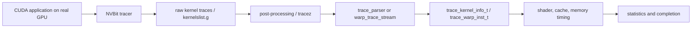

# Trace pipeline

## Current evidence

The intended path is:

Source evidence for producer structs and Hopper cluster/TMA fields is in
`util/tracer_nvbit/tracer_tool/{common.h,tracer_tool.cu,tracez_format.h}`;
consumer evidence is in `gpu-simulator/{trace-parser,trace-driven}`.

The verified simulator-side path is:

`gpu-simulator/main.cc`
→ `accel_sim_framework::simulation_loop()`
→ `parse_commandlist()`
→ `trace_parser::parse_kernel_info()` / `create_kernel_info()`
→ `trace_gpgpu_sim::launch()`
→ `gpgpu_sim::cycle()`
→ `trace_shader_core_ctx::get_next_inst()`
→ scheduler `issue_warp()`
→ ordinary shader/cache/interconnect/memory timing. For memory instructions,
`simt_core_cluster::icnt_inject_request_packet()` calls `icnt_push`, and
`gpgpu_sim::cycle()` calls `icnt_pop`/`icnt_transfer` in the configured clock
domain. The producer-to-disk and one-real-instruction portions still need an
actual A800 artifact.

## Reproduction status

No new A800 trace was generated in this phase: the NVBit binary/SDK was not
present and the only GPU was busy. A fresh replay of the existing V100
`hotspot` trace passed in about 40 seconds and emitted request/reply network
statistics. This validates the software replay path only; it does not validate
A800/H100 SASS or NVLink. The next run must use a tiny real A800 benchmark and
record every command and artifact. A real-instruction autopsy is still open.
