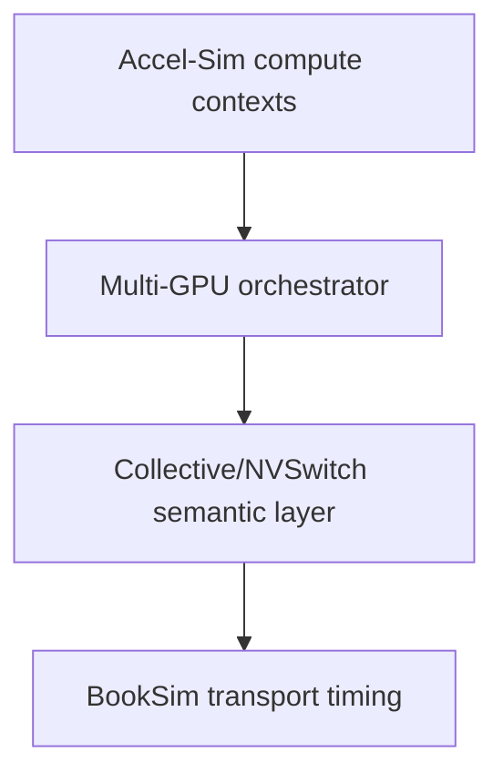

# Accel-Sim ↔ BookSim integration

An Accel-Sim↔BookSim adapter already exists for the GPU memory path. The
candidate research boundary for multi-GPU communication is therefore:

The reusable lower-level interface is
`InterconnectInterface::CreateInterconnect/Push/Pop/Advance/Busy`, backed by
`GPUTrafficManager` and `Network`. It currently maps shader/memory device IDs
and converts `mem_fetch` types to flit types. It does not provide rank,
collective, peer GPU, multicast, or switch-side reduction semantics.

The current GPU cycle coupling is source-verified: `gpgpu_sim::cycle()` uses
`next_clock_domain()`, invokes cluster `icnt_cycle()` on the ICNT mask, moves
L2 requests/replies with `icnt_pop`, and calls `icnt_transfer()` on the ICNT
mask. The Hopper config declares separate core/interconnect/L2/DRAM
frequencies. This is a clock-domain hook, not yet a multi-GPU global-time
contract.

Clock coupling between a future collective layer and Accel-Sim is unresolved.
The existing `intersim2` `Advance()` is called from the GPU timing loop, but the
research must verify the exact cycle order and clock-domain conversion before
reusing it for a second endpoint domain. Options are lockstep cycles, explicit rational
clock ratios, event-driven global time, or batched advancement. The choice must
be justified from event ordering and performance needs; never silently equate
one Accel-Sim cycle with one BookSim cycle.
