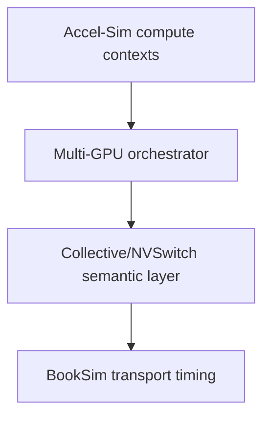

# Accel-Sim ↔ BookSim integration

No adapter exists yet. The candidate boundary is:

Clock coupling is unresolved. Options are lockstep cycles, explicit rational
clock ratios, event-driven global time, or batched advancement. The choice must
be justified from event ordering and performance needs; never silently equate
one Accel-Sim cycle with one BookSim cycle.
