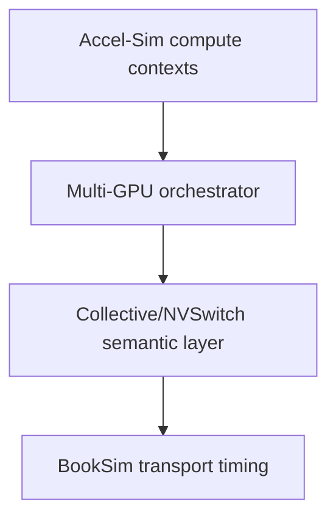

# Accel-Sim ↔ BookSim integration

An Accel-Sim↔BookSim adapter already exists for the GPU memory path. The
candidate research boundary for multi-GPU communication is therefore:



The reusable lower-level interface is
`InterconnectInterface::CreateInterconnect/Push/Pop/Advance/Busy`, backed by
`GPUTrafficManager` and `Network`. It currently maps shader/memory device IDs
and converts `mem_fetch` types to flit types. It does not provide rank,
collective, peer GPU, multicast, or switch-side reduction semantics.

The current GPU cycle coupling is source-verified: `gpgpu_sim::cycle()` uses
`next_clock_domain()`, invokes cluster `icnt_cycle()` on the ICNT mask, moves
L2 requests/replies with `icnt_pop`, and calls `icnt_transfer()` on the ICNT
mask. The Hopper config declares separate core/interconnect/L2/DRAM
frequencies. This is a clock-domain hook, not yet a multi-GPU global-time
contract.

Clock coupling between a future collective layer and Accel-Sim is now a design
decision, not an implementation claim. A future adapter should expose a narrow
transport API:

```text
create_network(config, endpoint_count)
inject_message(src, dst, bytes, tag, ready_time_ps) -> injection_status
advance_to(time_ps)
poll_completed() -> {tag, src, dst, bytes, completion_time_ps}
read_stats() -> transport_stats
```

The adapter owns packetization (`ceil((bytes + protocol_overhead) /
flit_bytes)`), endpoint tags, and completion at tail-flit ejection. BookSim
owns topology, routing, virtual channels, buffering, arbitration, and transport
latency only. Rank/collective lifecycle, multicast groups, reduction operands,
and NVSwitch/NVLS semantics remain above this boundary.

The recommended clock contract is event-driven with an integer global time in
picoseconds. Given GPU and network periods as rational values, `advance_to(t)`
advances BookSim while the next network edge is `<= t`; a rational accumulator
avoids floating-point drift. GPU callbacks enqueue communication events at their
GPU-domain timestamp and consume completions at the corresponding global time.
This supports unequal GPU/interconnect clocks and preserves ordering at equal
timestamps. A lockstep or fixed batch can be added as an optimization only if it
uses the same conversion contract. One Accel-Sim cycle must never be silently
treated as one BookSim cycle.

The external BookSim `TrafficManager` currently exposes `Run()` but keeps
per-cycle `_Step`, injection, and completion queues protected. Therefore a
packet-granular embedded adapter requires a small upstream-tracked facade (or a
subclass exposing these operations); invoking the standalone executable is not a
valid substitute for clock-coupled injection. This phase intentionally documents
the boundary without modifying BookSim or Accel-Sim core code.
