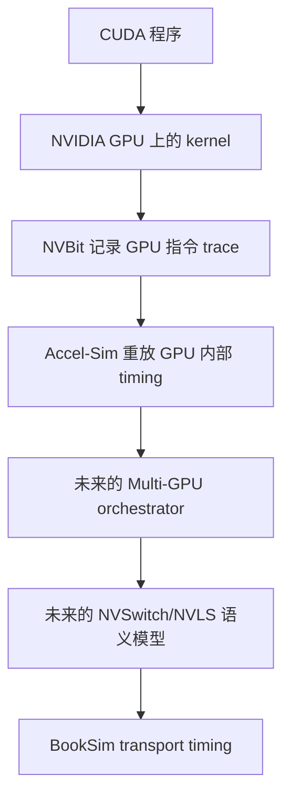

# 给项目研究者的概念和调用路径说明

这是一份面向人的入门文档。它不假设读者已经熟悉 CUDA、GPU 微体系结构、
NCCL 或 BookSim。阅读顺序是：先理解 GPU 如何执行一个 kernel，再理解一条
trace instruction 如何进入 Accel-Sim，最后理解多 GPU collective 为什么需要
额外的通信事件和 NVSwitch/NVLS 模型。

## 1. 先建立一张总图

我们的目标系统可以先看成五层：



前四层当前已经有真实 A800 证据。后面三层目前主要是设计和 synthetic
prototype。最重要的分界是：

- Accel-Sim 主要回答“一个 GPU 内部的指令多久完成”。
- BookSim 主要回答“一个已经形成的网络 packet/flit 如何经过网络”。
- Multi-GPU/NVSwitch/NVLS 层回答“为什么产生这些通信、谁参与、何时完成、
  是否在交换机中做 reduction”。

## 2. CUDA 程序是怎样在 GPU 上运行的

### 2.1 Kernel

CUDA 程序通常由 CPU 端代码和 GPU 端代码组成。CPU 端发起一个 GPU 函数，
这个 GPU 函数叫 kernel。比如 vector addition kernel 会把两个数组的每个
元素相加。

一次 kernel launch 包含：

- grid：这次任务总共有多少个工作块。
- block：一个工作块包含多少个线程。
- stream：GPU 用来安排异步工作的顺序队列。
- kernel arguments：输入数组、输出数组和长度等参数。

当前 A800 vectoradd 的一个 kernel 有 98 个 CTA，每个 CTA 有 1,024 个
线程。

### 2.2 CTA / thread block

CTA 是 Cooperative Thread Array 的缩写，在 CUDA 编程模型里通常就是
thread block。它是一组可以一起运行、可以使用 block-level barrier 的线程。

一个 block 会被放到某个 SM 上执行。不同 block 通常可以并行执行，但 block
之间不能直接假设任意执行顺序。

### 2.3 Warp 和 lane

GPU 不会一次独立调度 1,024 个线程，而是把线程分成大小通常为 32 的 warp。

- warp：硬件调度的基本 SIMD/SIMT 单位。
- lane：warp 中的一个线程位置，编号 0 到 31。
- warp instruction：一条 SASS 指令通常由整个 warp 共同发出。

因此一条 trace record 通常描述“一条 warp 指令”，而不是只描述一个线程。

### 2.4 SM

SM 是 Streaming Multiprocessor。它包含 warp scheduler、register file、
整数/浮点/tensor 执行单元、load/store pipeline 和 L1/shared memory 等。

H100 的 SM 是 SM90；A800 的 SM 是 SM80。两者不是同一代硬件，所以 A800
trace 不能直接证明 H100 的 instruction timing。

## 3. PTX、SASS、opcode 和 trace

### 3.1 PTX 和 SASS 的区别

PTX 是 CUDA 编译器生成的中间表示，类似“面向 GPU 的汇编源代码”。真正运行
时，PTX 会被编译成某一代 GPU 的机器指令，也就是 SASS。

例如：

```text
PTX:  ld.global.u64
SASS: LDG.E.64
```

PTX 可能在不同 GPU 上生成不同 SASS。因此研究 H100 instruction behavior
时，最好使用 H100 编译并执行产生的 trace。

### 3.2 opcode

opcode 是指令的操作类型。例如 `MOV` 是移动，`IADD` 是整数加法，`LDG` 是
global memory load，`STG` 是 global memory store，`QGMMA/HGMMA/IGMMA` 是
Hopper GMMA 类别，`SYNCS` 是 Hopper synchronization/mbarrier 类别。

`LDG.E.64` 中的核心 opcode 是 `LDG`，`.E.64` 是描述访问形式和宽度的修饰
部分。

### 3.3 PC

PC 是 Program Counter，表示当前指令在 kernel machine code 中的位置。它不是
内存数据地址，而是“下一条要执行哪条指令”的地址。

### 3.4 active mask 和 predicate mask

一个 warp 有 32 个 lane，但分支之后不一定每个 lane 都执行同一条指令。

- active mask：当前 warp 中哪些 lane 仍然活跃。
- predicate mask：这条指令的条件谓词允许哪些 lane 执行。
- 最终执行 mask：两者的交集。

当前真实记录里的 `ffffffff` 是 32-bit mask，32 位都是 1，表示 32 个 lane
都参与这条指令。

### 3.5 register 和 register dependency

寄存器是 GPU 内部很快的临时存储。例如：

```text
R4 = R2 + R3
```

这里 `R2/R3` 是输入，`R4` 是输出；下一条读取 `R4` 的指令必须等待它完成，
这就是 register dependency。模拟器用它判断 warp 是否 ready。

当前 Accel-Sim parser 将 SASS `R4` 映射为内部寄存器索引 `R5`，因为
GPGPU-Sim 的内部寄存器编号从 1 开始，而 SASS 从 `R0` 开始。这是编号约定
变化，不是程序真的多了一个寄存器。

## 4. NVBit trace 是什么

NVBit 是 NVIDIA 的 binary instrumentation framework。它允许 tracer 在 GPU
指令附近插入记录函数。

当前 tracer 记录 CTA、warp、PC、active/predicate mask、opcode、寄存器、memory
width、每个 lane 的地址，以及 Hopper cluster/TMA/mbarrier 相关 metadata。

它记录的是“GPU 指令执行信息”，不是完整的应用执行时间线。普通 trace record
没有 NCCL collective、NVSwitch queue 或 switch reduction 字段。

## 5. 一条真实 A800 指令怎样进入 Accel-Sim

真实记录是：

```text
48 0 0 17 0 0 0 0 0 0 0 00a0 ffffffff 1 R4 LDG.E.64 1 R4 8 1 0x7f7490524700 8 0 0 0 NoVal
```

下面每一步先说“人话”，再说源码对象。

### 5.1 `inject_funcs.cu`

NVBit 插入的 device function 运行在 GPU 上。它用 ballot 得到 mask，读取 CTA、
warp、PC、opcode、寄存器和地址，然后由第一个 active lane 把一条
`inst_trace_t` 推入 channel。

源码：`util/tracer_nvbit/tracer_tool/inject_funcs.cu:53-155`。

### 5.2 `tracer_tool.cu`

host-side tracer 从 channel 取出 `inst_trace_t`，按约定字段写入 trace 文件。
当前记录的核心字段是 PC `0x00a0`、mask `0xffffffff`、destination `R4`、
opcode `LDG.E.64`、source `R4`、width 8，以及 base/stride 地址。

源码：`util/tracer_nvbit/tracer_tool/tracer_tool.cu:1345-1481`。

### 5.3 post-processing 和 `tracez`

原始文本 trace 很大。post-processing 按 CTA/warp 分组、建立索引、压缩
instruction chunks，并写出 `.tracez`。这主要改变文件布局和地址编码，不改变
指令含义。

源码：`util/tracer_nvbit/tracer_tool/traces-processing/post-traces-processing.cpp:661-893`。

### 5.4 `TracezReader` 和 `parse_from_string`

Accel-Sim 打开 `.tracez` 后，先读 header、dictionary 和 CTA/warp index；需要
某个 warp 的 instruction 时，再解压对应 chunk。

源码：

```text
gpu-simulator/trace-parser/warp_trace_stream.h:55-123,317-324
gpu-simulator/trace-parser/trace_parser.cc:152-327
```

`inst_trace_t::parse_from_string()` 把文字字段转换为 C++ 字段：`00a0 → m_pc`、
`ffffffff → mask`、`LDG.E.64 → opcode`、`base+stride → lane addresses`。

### 5.5 `trace_shd_warp_t::get_next_trace_inst`

模拟器按 warp 读取下一条 trace instruction，创建一个 `trace_warp_inst_t`。
它是模拟器内部的 warp instruction，之后会被 scheduler 当作普通
`warp_inst_t` 使用。

源码：`gpu-simulator/trace-driven/trace_driven.cc:84-148`。

### 5.6 `parse_from_trace_struct`

该函数把 trace record 转成 simulator state：保存 CTA/cluster、设置 mask/PC、
查 opcode map、设置 latency/initiation interval、保存寄存器和 lane addresses，
并把 `LDG` 标记为 global memory load。

源码：`gpu-simulator/trace-driven/trace_driven.cc:253-421`。

### 5.7 `func_exec_inst` 和 `generate_mem_accesses`

`func_exec_inst()` 表示 instruction 被执行；load/store 会调用
`generate_mem_accesses()`。后者做 memory coalescing：多个 lane 如果访问同一
cache line，可以合并为更少的 cache-line requests。因此 32 个 lane 不一定产生
32 个 memory request。

源码：

```text
gpu-simulator/trace-driven/trace_driven.cc:1142-1155
gpu-simulator/gpgpu-sim/src/abstract_hardware_model.cc:287-485
```

### 5.8 `icnt_inject_request_packet`、`icnt_push` 和 cache/L2/DRAM

这里的 `icnt` 是 interconnect 缩写。在当前 Accel-Sim 中，它是 shader、cache、
memory partition 之间的 GPU 内部网络，不是 NVLink。

`icnt_inject_request_packet()` 把 memory request 包装成 `mem_fetch`，选择目标
memory sub-partition，再调用 `icnt_push`。之后 request 经过 L1/L2/DRAM，响应
再返回 shader。

源码：

```text
gpu-simulator/gpgpu-sim/src/gpgpu-sim/shader.cc:5596-5618
gpu-simulator/gpgpu-sim/src/gpgpu-sim/gpu-sim.cc:2234-2355
```

### 5.9 `icnt_pop` 和 completion gate

`icnt_pop` 取出 memory response。warp 不能因为 trace 文件读完就立即结束，还要
满足：pipeline 没有未完成 instruction、没有卡在 barrier、store 已完成、
scoreboard 没有等待的寄存器写回。这些条件就是 completion gate。

源码：`gpu-simulator/gpgpu-sim/src/gpgpu-sim/shader.cc:5702-5741` 和
`gpu-simulator/trace-driven/trace_driven.cc:1034-1058`。

## 6. CTest、hotspot trace 和 request/reply packets

### 6.1 CTest

CTest 是 CMake 的测试运行器。只有通过 `add_test()` 注册的测试才会被发现。
因此 `ctest → No tests found` 只表示当前 build 没有注册 CTest case，不能解释
成“所有测试通过”。所以本项目还需要显式运行 Python unit test、shell smoke
和 simulator replay。

### 6.2 hotspot trace

hotspot 是用于产生规则计算/内存负载的 CUDA benchmark。项目里的 V100 hotspot
trace 可以检查 parser、kernel launch、shader/cache/memory path 是否结束；但
它不能证明 A800、H100、NVLink 或 NVLS，因为 trace/config 来自 V100 场景。

### 6.3 request/reply network packets

当前 GPU memory system 中：

- request packet：shader 发给 memory partition 的请求，例如读 cache line。
- reply packet：memory system 返回数据或 write acknowledgement。

之前 A800 replay 的 75,000 request 和 75,000 reply 是 GPU 内部 memory path
统计，不是 NVLink packet、NVSwitch packet、NCCL message 或 NVLS reduction。

## 7. 多 GPU 和 NCCL 的基本概念

### 7.1 device、rank、peer

- device：物理 GPU，例如 CUDA device 0。
- rank：一个 collective participant 的逻辑编号；不能简单等同于 device id。
- peer：通信另一端的 GPU。

单卡 trace 知道 kernel 在某个 CUDA context 中运行，但不自动知道它在 NCCL 中
是 rank 3，或者 peer 是哪张 GPU。

### 7.2 communicator

NCCL communicator 是参与通信组的上下文，维护 rank 数量、当前 rank、连接方式、
channels、算法和 transport resources。没有 communicator 信息，模拟器无法知道
一次 message 应该等待哪些参与者。

### 7.3 collective

collective 是一组 GPU 共同参加的通信操作：

- AllReduce：每个 GPU 提供数据，最后每个 GPU 得到相同的归约结果。
- AllGather：每个 GPU 提供一段数据，最后每个 GPU 得到全部数据。
- ReduceScatter：先归约，再把不同结果片段分给不同 GPU。
- Broadcast：一个 GPU 把数据发送给多个 GPU。

collective 有参与者集合、统一完成条件和通常固定的算法阶段。

### 7.4 Ring、reduce-scatter、all-gather

Ring AllReduce 通常分两段：

1. reduce-scatter：数据片段沿 ring 传递并累加，最终每个 rank 拥有一个已归约
   片段。
2. all-gather：每个 rank 把自己的归约片段沿 ring 传播，最终所有 rank 拥有
   完整结果。

因此 AllReduce 不是一条大 packet，而是多个阶段、chunk 和方向的通信事件。

### 7.5 message、partition、chunk、channel

- message：一次 collective 需要传输的逻辑数据，例如 1 MiB。
- partition：把大 message 切成多个部分。
- chunk：实际调度/传输的较小片段。
- channel：NCCL 并行推进通信的逻辑通道；多个 channel 增加并行度，也增加
  network contention。

### 7.6 dependency、completion、overlap

- dependency：事件 B 必须等事件 A 完成。
- collective completion：所有 rank 都满足 collective 完成条件。
- compute/communication overlap：GPU 一边计算，一边通过另一条 stream 或
  pipeline 进行通信。

只复制 compute trace 会丢失这些时间关系，因此无法得到正确 end-to-end runtime。

## 8. NVLink、NVSwitch、BookSim 和 AnyNet

### 8.1 NVLink 和 NVSwitch

NVLink 是 GPU 之间的高速互联链路，定义物理带宽、链路方向和协议。NVSwitch
是连接多张 GPU 的交换芯片，可能包含 ports、routing、buffers、queues、flow
control、credits 和 multicast/reduction 资源。

### 8.2 packet、flit、credit

- packet：一次逻辑网络消息。
- flit：packet 被切成的固定大小传输单元。
- credit：接收端告诉发送端还有多少 buffer 空间，防止溢出。

BookSim 通常以 flit 为 timing 单位，因此需要：

```text
message bytes → packetization → flit count → route/arbitration → delivery
```

### 8.3 AnyNet

AnyNet 是 BookSim 的通用拓扑描述方式。当前 prototype 用两个 router 表示：

```text
logical GPU 0 → router 0 ↔ router 1 ← logical GPU 1
```

它只说明 generic packet transport 可以运行，不表示真实 H100 NVSwitch 的端口、
路由或 latency。

### 8.4 multicast 和 switch-side reduction

multicast 是“一次发送，多个 endpoint 收到”；真实 NVSwitch 的 multicast 有
资源限制，不能简单复制 packet。switch-side reduction 则是在交换设备中执行
加法等运算，例如 `value0 + value1 + value2`，因此还需要 reduction resource、
operand ordering、operator、precision 和 completion timing。

## 9. NVLS 是什么

NVLS 可以先理解成利用 NVLink multicast 和 NVSwitch reduction 能力的 collective
transport/algorithm。它至少涉及：

1. communicator 判断 NVLS 支持。
2. 分配和绑定 multicast memory。
3. 建立 NVLS channels/tree。
4. GPU 使用 multimem 相关操作访问特殊 memory mapping。
5. NVSwitch 执行 multicast/reduction。
6. 所有参与者完成后 collective 才结束。

所以 NVLS 必须同时描述 GPU-side instruction、memory mapping、network transport、
switch reduction 和 collective completion。

## 10. endpoint/clock contract

当前 API 是：

```text
create_network(config, endpoint_count)
inject_message(src, dst, bytes, tag, ready_time_ps)
advance_to(time_ps)
poll_completed()
read_stats()
```

含义分别是创建网络、注入准备好的 message、推进到全局时间、取回完成事件、
读取统计。

### 10.1 为什么使用 picosecond

GPU core、interconnect、NVLink/NVSwitch 可能有不同频率。若默认一个 GPU cycle
等于一个 network cycle，会隐藏时钟比例错误。当前设计使用 integer picosecond
global time 和精确 rational period，例如 network period 为 250 ps 时，network
edge 在 0、250、500、750、1000、1250 ps 出现。

### 10.2 为什么 standalone `Run()` 不够

BookSim `TrafficManager::Run()` 自己控制 simulation loop，per-cycle `_Step()`、
injection 和 completion queue 处于 protected/private 边界。standalone executable
适合固定 traffic pattern 的平均 latency/throughput，不适合 Accel-Sim 在任意
event 时间点注入。未来需要最小 facade 暴露 per-cycle advance、injection 和
completion。

## 11. 如何理解当前结果

- `75,000 request/reply packets`：GPU memory model 的内部请求/响应，不是 NVLink。
- `BookSim latency = 12 cycles`：当前 AnyNet 配置下的 synthetic latency，不是
  H100 NVLink latency。
- `trace replay PASS`：trace 可以被 simulator pipeline 读取并完成 timing simulation，
  不代表 trace 包含 NCCL/NVLS，也不代表硬件性能相关。
- `H100 support partial`：源码有 SM90 config/opcode/handling，但还没有真实 H100
  trace 和硬件 correlation。

## 12. P2 audit 的源码结论

| 项目 | 当前源码证据 | 结论 |
|---|---|---|
| SM90 config | `configs/tested-cfgs/SM90_H100/gpgpusim.config` | 配置存在 |
| binary version 90 | `hopper_opcode.h`、`trace_driven.cc:198-200` | 选择 Hopper opcode map |
| GMMA | `OP_QGMMA/HGMMA/IGMMA`、latency mapping | 有 model path，需 H100 trace 验证 |
| TMA | `UTMALDG/UTMASTG/UTMAREDG`、TMA metadata | partial；prefetch 明确未实现 |
| mbarrier/SYNCS | `parseSASSInstruction` 和 shader state | partial；要求 register-value trace |
| cluster/DSM fields | CTA/cluster/rank fields | 有 trace fields；不是 multi-GPU rank |
| `multimem` | source search 无 symbol | 当前没有 simulator semantics |
| NVLink/NVSwitch/NVLS | 没有 GPU↔GPU timing path | 未实现 |

关键限制：真实 H100 trace replay 尚未进行；A800 trace 不能验证 SM90 semantics；
TMA multicast metadata 是 Hopper memory/cluster 语义，不等于 NVLS multicast；
`cluster_rank` 是 CTA 在 thread-block cluster 内的 rank，不是 NCCL GPU rank。

详细源码位置：

```text
gpu-simulator/trace-driven/trace_driven.cc:198-219
gpu-simulator/trace-driven/trace_driven.cc:560-690
gpu-simulator/trace-driven/trace_driven.cc:694-859
gpu-simulator/ISA_Def/trace_opcode.h:231-255
gpu-simulator/ISA_Def/hopper_opcode.h:13-19,187-219
gpu-simulator/gpgpu-sim/configs/tested-cfgs/SM90_H100/gpgpusim.config
```

## 13. 读完后应该形成的判断

1. trace 是 GPU instruction workload，不是完整 distributed execution。
2. 当前 `icnt` 是 GPU 内部 memory network，不是 NVLink。
3. request/reply packet 统计不能直接解释成 NCCL traffic。
4. AnyNet 是 BookSim generic topology，不是 NVIDIA topology。
5. `multimem` 是 GPU-side instruction，但 NVLS 还需要 switch-side semantics。
6. 当前最合理的数据模型是 compute trace + communication event trace。
7. A800 可以完成软件和 synthetic 阶段，但真实 H100/NVLS 仍需要 H100 NVSwitch。
