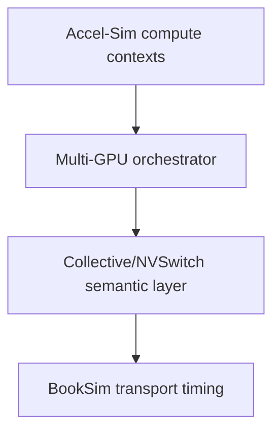

# BookSim 与多 GPU 网络边界

当前有两个相关版本。reference checkout 是 `../booksim2`
(`28f4329`, `master`). Accel-Sim's nested GPGPU-Sim checkout contains a
BookSim2-derived `src/intersim2` with extra `InterconnectInterface`,
`GPUTrafficManager`, and GPGPU-Sim build integration. It is already used for
the GPU-to-memory network when `-network_mode 1` selects it.

reference checkout 中经 source verification 的 core components 包括 `Network`、
topology implementations, `Router`/`Channel`, `Flit`/`Credit`, VC/buffer,
`TrafficManager`, routing/configuration, `ReadInputs/Evaluate/WriteOutputs`,
and `_Step()` simulation advancement. The standalone run completed on
2026-09-18: `make -C src -j8` passed, and `src/booksim
src/examples/singleconfig` produced latency/throughput statistics and then
ended with the example's convergence/unstable-simulation message. This
validates the standalone executable path only.

现有 GPU adapter 已提供所需的概念接口：
`create_network`, `inject_packet`, `advance_cycle`, `query_completion`, and
`collect_stats` (concretely `CreateInterconnect`, `Push`, `Advance`, `Pop`,
`Busy` 和 stats calls）。待决定的问题是：为 logical GPU endpoint 扩展该边界，
还是新增独立 orchestrator，以免复用并扭曲 memory-node assumptions。

## Two-GPU NVLink transport prototype

首个 prototype 使用 standalone reference checkout，不复制 source tree。在
BookSim `28f4329` 中，`AnyNet` 创建两个 router，每个 router 一个 endpoint，
并用一条 bidirectional router link 连接。文件位于
`tools/booksim_nvlink/`; `bitcomp` with two nodes maps node 0 to node 1 and
node 1 to node 0 deterministically.

smoke test 以 BookSim 历史上的 success status 255 通过（其
`main()` returns `-1` when `TrafficManager::Run()` returns true; the wrapper
会被 wrapper normalize）。测试确认了两个 node listing、有限 packet latency、
two hops，以及一致的 injected/accepted rates。one-flit、one-cycle-link case
为 12 network cycles。

该 sweep 改变 link latency（1/4/8 cycles）和 packet size（1/4/16 flits）。
Latency increased monotonically: 12/13.4118/15.2941 cycles for one flit and
27/30.2941/35.9412 cycles for 16 flits. This is a generic transport sanity and
sensitivity result, not physical NVLink calibration. It does not yet provide
an embedded Accel-Sim API, clock coupling, protocol overhead, or bandwidth
mapping.

## Accel-Sim ↔ BookSim 耦合设计

GPU memory path 已有 Accel-Sim↔BookSim adapter，因此 multi-GPU communication
的候选研究边界为：



可复用的 lower-level interface 是
`InterconnectInterface::CreateInterconnect/Push/Pop/Advance/Busy`, backed by
`GPUTrafficManager` 和 `Network`。它目前映射 shader/memory device ID，并将
`mem_fetch` type 转成 flit type；不提供 rank、collective、peer GPU、multicast
或 switch-side reduction semantics。

当前 GPU cycle coupling 已通过 source verification：`gpgpu_sim::cycle()` 使用
`next_clock_domain()`, invokes cluster `icnt_cycle()` on the ICNT mask, moves
L2 requests/replies with `icnt_pop`, and calls `icnt_transfer()` on the ICNT
mask. The Hopper config declares separate core/interconnect/L2/DRAM
frequencies。这是 clock-domain hook，还不是 multi-GPU global-time contract。

未来 collective layer 与 Accel-Sim 的 clock coupling 目前只是 design
decision，不是 implementation claim。adapter 应暴露精简 transport API：

```text
create_network(config, endpoint_count)
inject_message(src, dst, bytes, tag, ready_time_ps) -> injection_status
advance_to(time_ps)
poll_completed() -> {tag, src, dst, bytes, completion_time_ps}
read_stats() -> transport_stats
```

adapter 负责 packetization（`ceil((bytes + protocol_overhead) / flit_bytes)`）、
endpoint tag，以及 tail-flit ejection 时的 completion。BookSim 只负责
topology、routing、virtual channel、buffering、arbitration 和 transport
latency。Rank/collective lifecycle、multicast group、reduction operand 与
NVSwitch/NVLS semantics 位于该边界之上。

推荐 clock contract 采用 event-driven 模式，并用整数 picoseconds 表示 global
time。当 GPU 与 network period 以 rational value 表示时，`advance_to(t)` 在
下一个 network edge `<= t` 时推进 BookSim；rational accumulator 可避免
floating-point drift。GPU callback 在自身 GPU-domain timestamp 入队
communication event，并在对应 global time 消费 completion。该设计支持不同
GPU/interconnect clock，并保持相同 timestamp 下的 ordering。lockstep 或
fixed batch 只能在复用同一 conversion contract 时作为优化。绝不能默认把
一个 Accel-Sim cycle 当成一个 BookSim cycle。

外部 BookSim `TrafficManager` 当前暴露 `Run()`，但仍将 per-cycle `_Step`、
injection 和 completion queue 设为 protected。因此 packet-granular embedded
adapter 需要一个小型 upstream-tracked facade（或暴露这些操作的 subclass）；
调用 standalone executable 不能替代 clock-coupled injection。本阶段只记录
该边界，不修改 BookSim 或 Accel-Sim core code。
