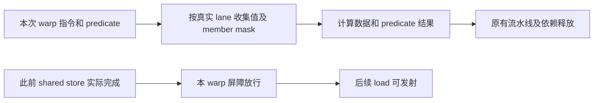

# 阶段 1 实际实现：基础数值与 warp 协作

状态：**已完成（实现及自测）**。现在可在 PTX 周期模式下独立运行真实转换、top-k/排序、计数、完整行映射、重排和 SwiGLU，得到正确结果和周期统计。构建、必要微测、11 个冻结模块及受影响回归均通过；坐标标记重排的收尾复核也已通过。独立验收已于 2026-11-08 **通过**，范围见下方独立验收记录。硬件性能对照由用户暂缓，保留通用 prompt 供后续使用。

[实现方案](../../../plans/stage-1.md) · [验收要求](../../../validation/stage-1.md) · [独立验收记录](../../validation/stage-1/README.md)

## 当前结论与范围

阶段 0 已独立验收。本轮实现三种 BF16 转换、显式 mask 集合操作、warp 屏障、位操作/缓存提示及相关时序，并运行 11 个未改动的冻结 Qwen64/128 模块。输入由 host 构造，CPU 独立计算预期，不依赖尚未实现的 gating/专家 GEMM，也未启动完整前向。

集合操作先读齐本次参与线程的原始输入，再统一写回。这避免把 lane16～31 错当作 lane0～15，也避免原地 shuffle 读到已覆盖的值。功能寄存器在发射时更新；后续消费者仍等待原 scoreboard（寄存器就绪记录）和流水线写回。



## 实际改动与计划对应

以下源码路径均属于独立内层仓库。每项“完成”指实现及自测，不替代独立验收。

| 对应 plan | 状态 | 文件、函数/状态及行为 |
| --- | --- | --- |
| [BF16 转换](../../../plans/stage-1.md#numeric) | 完成 | [ptx.l](../../../../gpu-simulator/gpgpu-sim/src/cuda-sim/ptx.l)、[ptx.y](../../../../gpu-simulator/gpgpu-sim/src/cuda-sim/ptx.y)、[ptx_ir.cc](../../../../gpu-simulator/gpgpu-sim/src/cuda-sim/ptx_ir.cc) `type_decode`、[ptx_parser.cc](../../../../gpu-simulator/gpgpu-sim/src/cuda-sim/ptx_parser.cc) 类型宽度；[instructions.cc](../../../../gpu-simulator/gpgpu-sim/src/cuda-sim/instructions.cc) `f32_to_bf16`/`cvt_impl`。新增 BF16/BF16x2 位类型，在旧通用转换表前处理 `cvt.f32.bf16`、`cvt.rn.bf16.f32`、`cvt.rn.bf16x2.f32`，正确舍入和处理特殊类别，打包 a 在高半、b 在低半。 |
| [集合操作](../../../plans/stage-1.md#collectives) | 完成 | [opcodes.def](../../../../gpu-simulator/gpgpu-sim/src/cuda-sim/opcodes.def) 新增 redux/elect；[ptx_ir.h](../../../../gpu-simulator/gpgpu-sim/src/cuda-sim/ptx_ir.h)/`ptx_ir.cc` 保存 `.sync`、elect 的隐含 b32 类型。新增 `collective_impl`，替换旧 shuffle 的线程计数和 vote 的函数静态累积；支持三种 shuffle、ballot、32 位整数求和、确定性 leader 及双目的。 |
| 同上：执行和依赖 | 完成 | [abstract_hardware_model.cc](../../../../gpu-simulator/gpgpu-sim/src/abstract_hardware_model.cc) `core_t::execute_warp_inst_t` 在逐 lane predicate 求值后执行一次集合；[cuda-sim.cc](../../../../gpu-simulator/gpgpu-sim/src/cuda-sim/cuda-sim.cc) `ptx_exec_inst` 不逐 lane 改写集合结果，`pre_decode` 登记全部普通源和逐个目的，排除 `_`。shuffle 第四源、BF16x2 两源及数据/predicate 双目的进入原依赖路径。 |
| [warp 屏障](../../../plans/stage-1.md#warp-barrier) | 完成 | 删除 lexer 原有把 `bar.warp` 识别成 NOP 的规则；保存 `.warp` 范围，mask 作为读取源。`collective_impl` 检查参与者；[abstract_hardware_model.h](../../../../gpu-simulator/gpgpu-sim/src/abstract_hardware_model.h) 携带标记；[shader.h](../../../../gpu-simulator/gpgpu-sim/src/gpgpu-sim/shader.h)/[shader.cc](../../../../gpu-simulator/gpgpu-sim/src/gpgpu-sim/shader.cc) 复用 warp membar，等待已发射流水退出和 store 确认，不进入 CTA 到达计数。 |
| [位操作与 load](../../../plans/stage-1.md#bits-loads) | 完成 | [ptx_sim.cc](../../../../gpu-simulator/gpgpu-sim/src/cuda-sim/ptx_sim.cc) `get_builtin` 返回 `%lanemask_le`；`bfind_impl` 修正无符号循环和移位掩码，增加 shiftamt 变换。接受三种 eviction hint load，保留宽度、地址、谓词、请求和正常缓存通路。 |
| 真实访存写法 | 完成 | `ptx_recognizer::add_1vector_operand` 将 ld/ldu/st 的单元素 `{ %r }` 规范为标量；旧实现把指针数组误当符号，导致 `set_reg` 失败。tex 单坐标向量保留原表示。真实消费者覆盖 b8/b16/b32/b64 及向量访存。 |
| [时序](../../../plans/stage-1.md#timing) | 完成 | [H100 配置](../../../../gpu-simulator/gpgpu-sim/configs/tested-cfgs/SM90_H100/gpgpusim.config) 补 integer 第六项 SHFL 为 latency 4/initiation 2；`set_opcode_and_latency` 将 redux 接专用单元 4（4/1），elect 接单元 1（4/4），复用端口、依赖和完成处理。 |
| 阶段 0 所属加载修复 | 完成，自测回归 | `ptx.y` 接受并保留 `.reqntid x,y,z`，复用线程数资源元数据；`ptx.l` 跳过冻结 PTX 中单层花括号的 `.debug_*` DWARF 段，保留执行代码和 `.file/.loc`。另记[阶段 0 实现记录](../stage-0/README.md)。 |

测试源码见 [stage-1](../../../../workloads/moe/tests/hopper/stage-1/)：`host.h`/`micro.cc` 延用阶段 0 的 fatbinary 注册、直接启动和时间戳；`generate_micro.py` 保存人工预期；`read_forward.py` 按原 launcher 格式读冻结记录；`real.py`/`real.cc` 保留 entry、参数字节和 launch，只替换指针并准备所需缓冲。`observe.gdb.py` 只读观察；`summarize.py` 核对证据并汇总。

## 复用与建模说明

当前微测和真实 top-k/排序均在一次动态 warp 指令中到齐，故只用最多 32 项临时输入，没有新增持久等待状态或重写 SIMT 调度。member mask 仅排除已退出线程；缺少指定的存活参与者时明确报 PC/mask/active 并失败，不缩小集合冒充完成。redux 用无符号累加保留低 32 位；elect 选最低有效 lane。shfl/elect 的 `数据|predicate` 复用双符号表示，predicate 按内部低位 0 为真写入；`_|p` 只登记 predicate 写依赖，原 PTXPlus 赋值规则不变。

shared store 没有目的寄存器，仅看 scoreboard 会漏等，因此 warp 屏障同时等本 warp 已发射流水和 store 确认。当前也会保守等待该 warp 已发射的其它指令；不扩大到其它 warp/CTA，也不做整 SM 的 L1 失效。

借用 Hopper SASS 的 SHFL/VOTE ALU 分类、BRA/UDP 参数及共用端口、访存、依赖和写回模型；PTX 自己生成值、mask 和地址。既有专用资源初始化要求连续编号，为使用 4 必须同时声明 2/3 的 TEX/TENSOR 资源；本轮新 PTX 指令只分派给 1/4，没有启用 GMMA 单元 5。新增 warp 屏障标记默认 false，普通 SASS membar 继续原等待条件。

BF16 使用位存储，不映射到 FP16，也不扩充旧转换矩阵。打包次序及特殊类别依据 [PTX 8.7 cvt](https://docs.nvidia.com/cuda/archive/12.8.1/parallel-thread-execution/index.html#data-movement-and-conversion-instructions-cvt)。微测预期来自固定表，真实激活参考由独立 CPU 舍入和 `x/(1+exp(-x))*y` 生成。

## 构建与自测证据

完整结果、设备计数和主机成本见 [summary.json](../../../../workloads/moe/runs/hopper-stage-1/summary.json)。

| 自测范围 | 结果与证据 |
| --- | --- |
| BF16/打包及旧转换 | 单值舍入、±0、无穷、NaN、无 ftz 位扩展、两源顺序和中点打包精确一致；一组 FP16/FP32/整数转换通过。[numeric.log](../../../../workloads/moe/runs/hopper-stage-1/micro-delivery/numeric.log)、[双源 decode/完成](../../../../workloads/moe/runs/hopper-stage-1/micro-delivery/observe-numeric.log)。 |
| warp 集合 | 两 warp 不串值，高半/运行时 mask、原地交换、边界 predicate、负数和、重复 leader、`_|p` 通过；shuffle 四个源都取寄存器，decode 四项均非零。[collectives-runtime](../../../../workloads/moe/runs/hopper-stage-1/collectives-runtime/)、[状态和依赖](../../../../workloads/moe/runs/hopper-stage-1/collectives-runtime/observe.log)。 |
| 屏障、位操作、hint load、旧 shuffle | 全/部分 mask 数据交换正确，另一 warp 不到达也完成；全 32 lane 位图、bfind 两种返回、b8 的 00/7f/80/ff、关闭谓词不写输出均通过。旧 shuffle 在合法 PTX 5.0/sm_60 模块回归。[九类微测](../../../../workloads/moe/runs/hopper-stage-1/micro-delivery/run.json)、[完整屏障事件](../../../../workloads/moe/runs/hopper-stage-1/micro-final/observe-warp.log)、[部分屏障事件](../../../../workloads/moe/runs/hopper-stage-1/micro-delivery/observe-partial.log)。 |
| 收尾 mask 依赖 | `pre_decode` 把 warp 屏障 mask 从目的改为源，部分 mask 测试用寄存器，全 mask 保留 -1。decode 已观察到 mask 为源且没有目的；重跑两种屏障、集合和数值：[final-warp-mask](../../../../workloads/moe/runs/hopper-stage-1/final-warp-mask/)。真实普通模块只用 CTA barrier，不受此处变更影响。 |
| 真实模块 70 | 原长度 131072，BF16→FP32 全输出位模式一致。[convert.log](../../../../workloads/moe/runs/hopper-stage-1/real-corrected/convert.log)、[原参数和 launch](../../../../workloads/moe/runs/hopper-stage-1/real-corrected/launches.json)。 |
| 真实模块 3→4 | 128 token、64 专家、top-4；先比未排序选中集合和值/编号配对，再比降序排序，512 对全部一致。[route.log](../../../../workloads/moe/runs/hopper-stage-1/route-delivery/route.log)。 |
| 真实模块 77→10→38→78→79→80→81 | 计数总和 512；前缀、全局行号、每 token 的 4 对映射、逆映射正确；重排及反向专家次序排列各 1048576 项一致。末轮每两个有限 BF16 元素联合标识 token 和完整列坐标：[mapping-delivery](../../../../workloads/moe/runs/hopper-stage-1/mapping-delivery/)。 |
| 真实模块 82 | 保留 512×2816 输入与 512×1408 输出，两半输入不同；720896 项全有限，最大绝对误差 0，沿用 `1e-5+0.02*abs(ref)`。[swiglu.log](../../../../workloads/moe/runs/hopper-stage-1/real-final/swiglu.log)。该目录早期 convert/mapping 失败记录不用于通过结论。 |
| 阶段 0 回归 | 八项全部符合预期，含两个预期非零失败出口。[run.json](../../../../workloads/moe/runs/hopper-stage-1/stage0-regression/run.json)。 |

时序检查也已通过：

- 32/64 条依赖 shuffle，latency 4→16，总周期分别 5570→5954、5794→6562，增加 384/768，等于条数×12；[latency16-delivery](../../../../workloads/moe/runs/hopper-stage-1/latency16-delivery/)。
- 32 warp 独立链固定 latency=32，仅改 initiation 2→8，总周期 15598→21490；前 64 次单元接收事件中，四个单元最小间隔分别都是 2/8。[initiation2](../../../../workloads/moe/runs/hopper-stage-1/initiation2/) / [initiation8](../../../../workloads/moe/runs/hopper-stage-1/initiation8/)。
- shared store 在 5046 完成，屏障 5047 放行，后续 load 在 5060 发起；warp1 到 6470 才完成自身 store。高半屏障也有 mask=arrived=`ffff0000` 及放行事件。redux/elect decode 为单元 4 的 4/1、单元 1 的 4/4，数据及 predicate 消费都经过完成处理。

## 主机成本与性能口径

测试配置只将 H100 的 SM 数 132→1、chiplet partition 2→1，容量、时钟及周期参数保持生产值；敏感性测试另只改 integer 第六项。单 SM 和人工输入不用于计算 H100/ncu 的 20% 误差。

| 实际程序 | 初始化及输入准备 | launch→同步 | 比较循环 | 进程墙钟 / 峰值 RSS |
| --- | ---: | ---: | ---: | ---: |
| 模块 70 | 1.112s | 19.728s | 0.0030s | 20.97s / 282.0MiB |
| 模块 3→4 | 0.927s | 59.156s + 15.740s | 0.0001s | 75.91s / 313.0MiB |
| 计数到排列，末轮坐标标记 | 0.872s | 合计 371.587s | 0.0320s | 374.62s / 334.8MiB |
| 模块 82 | 1.747s | 156.575s | 0.0257s | 158.68s / 301.0MiB |

初始化从 constructor 到首次提交，包含注册、分配、CPU 参考/输入准备及上传。launch→同步包含预解码和模拟；比较循环不含下载/写文件。`.time` 保存全进程；GDB 不用于墙钟预算。各调用成本在 summary 单列，不能据此承诺 WGMMA 或九例运行时间。

设备统计单列：模块 70 为 1310720 条线程指令；日志总周期 34357 含 launch。只读 GDB 得到开始 5001、结束 34356，实际内核区间 **29355 周期**：[observe-kernel.log](../../../../workloads/moe/runs/hopper-stage-1/real-corrected/observe-kernel.log)。其它模块保存各调用的 `gpu_sim_cycle`/`gpu_sim_insn`，周期明确标注含 launch，不直接当纯内核耗时。

## 修复记录与限制

真实加载暴露 `.reqntid`/DWARF、执行暴露单元素访存，均在模拟器所属位置修复，冻结程序未改。初次微测虽数值正确，`bar.warp` decode 仍是旧 NOP；删除优先匹配规则后用完成/放行/读取事件复验，初次数值不作为屏障支持证据。

两处测试参考也按源码修正：模块 70 原长度为 131072；模块 38 已加专家前缀，返回全局行号。旧失败日志保留，正确参考不调用模拟器实现。末轮重排用一对 BF16 元素编码坐标，避免单个 16 位标记在相隔 32 token 时重复。

当前没有阻塞本阶段消费者的已知问题。按计划暂缓：任意分歧/跨动态指令分批到达（当前真实路由未触发，遇到时必须补等待调度）；eviction hint 精细逐出策略（当前沿正常缓存通路）；其它 BF16 算术、redux 模式、未用寄存器及 H200 验收。gating、专家 GEMM 和完整九例属于后续阶段。

没有现成小 SASS trace，本轮未作 SASS 运行验收；PTX 及阶段 0 回归覆盖本次共用路径，新增标记默认 false 的普通 membar 分支保持原条件。后续获得相关 trace 时补运行证据。

## 版本、命令与交接

外层基准 `93dc07d702e3da9df17081f062f950119d621ff5`，内层基准 `62205297c2b0c7ba9ba1e275e6a9874f0c284a02`。内层交付提交 `b25fd0a18cb01a0c112042295007a0ac2c3772ad`；外层文档与测试由两仓库的 `stage1` 标签配对定位，标签说明记录双方提交号。原运行基准和工作区差异继续作为历史证据保留。主要自测差异：[inner-before-warp-mask.diff](../../../../workloads/moe/runs/hopper-stage-1/inner-before-warp-mask.diff)，SHA256 `fe6b04b83b8578e3a37de9fefff4808f7b39cc7dcc44647279088334a1e81ee7`。最后版本仅额外修正 warp 屏障寄存器 mask 依赖，针对性复跑绑定 [final-warp-mask/run.json](../../../../workloads/moe/runs/hopper-stage-1/final-warp-mask/run.json)。最终[源代码差异](../../../../workloads/moe/runs/hopper-stage-1/inner.diff)、[源码/测试/库散列](../../../../workloads/moe/runs/hopper-stage-1/versions.json)另存；格式化不算功能差异，历史运行不冒称用了最后一次构建的二进制。

CUDA 12.8 / ptxas V12.8.61、GCC 13.4.0，debug，clang-format 16.0.6；[构建日志](../../../../workloads/moe/runs/hopper-stage-1/development/build-final.log)。实际库为内层 `lib/gcc-13.4.0/cuda-12080/debug/libcudart.so.12`，ldd/注册日志确认，全部 `PTX_SIM_MODE_FUNC=0`。普通配置 SHA256：`e3d91789335d64379303f9233ba43cfa6c317e019115b5605c43f77672b27bbf`；各命令和敏感性配置见对应 `run.json`，原 PTX/forward.bin 散列见真实运行元数据，冻结文件无工作区差异。

验证 agent 建议先跑微测，再跑四组真实消费者，用新目录保留已有证据：

```bash
cd /home/wangjz/in-switch/accel-sim
source workloads/moe/runs/hopper-stage-0/independent-20261108/environment.sh
make -C gpu-simulator/gpgpu-sim -j8
python3 workloads/moe/tests/hopper/stage-1/run.py \
  --run-dir workloads/moe/runs/hopper-stage-1/recheck-micro
python3 workloads/moe/tests/hopper/stage-1/real.py \
  --run-dir workloads/moe/runs/hopper-stage-1/recheck-real
```

敏感性入口：`run.py --test chain32,chain64 --shuffle-latency 16`；以及固定 `--test throughput --shuffle-latency 32` 分别设置 `--shuffle-initiation 2/8`。在相应运行目录只读观察：

```bash
/usr/bin/gdb -q -batch \
  -x /home/wangjz/in-switch/accel-sim/workloads/moe/tests/hopper/stage-1/observe.gdb.py \
  --args ./micro collectives
```

可换 `numeric`、`warp_full`、`warp_partial`；`STAGE1_OBSERVE_TIMING=1` 记录 `./micro throughput` 单元接收，`STAGE1_OBSERVE_KERNELS=1` 记录 `./real convert` 设备起止。本轮固定证据断言为 `python3 workloads/moe/tests/hopper/stage-1/summarize.py workloads/moe/runs/hopper-stage-1`。

必要自测及独立验收已经完成，停止扩测。用户决定本次不开展硬件对照，也不启动阶段 2；后续需要时使用[硬件对照 prompt](../../hardware-baseline-prompt.md)。测试源码随本阶段提交；大型运行日志和输出保留本地，不纳入 Git。


## 阶段7消费者发现的32位地址修复

阶段7的原Qwen64/128暴露top-k shared读取错误：32位加法的内部高位进位被公共访存操作数求值当作64位地址，第四个入选专家覆盖已有结果。`instructions.cc`现在按地址寄存器声明宽度截断32位地址，保持64位地址行为。bits_loads新增64线程、32位shared地址读写64位数据的回归，debug/release均通过；相关算术、warp协作和矩阵访存回归也通过。完整原因、版本和证据见[阶段7实际记录](../stage-7/README.md#首个数值分歧32位地址读到了错误位置)。这是阶段7本轮实现自测，未改写本阶段历史独立验收结论。
