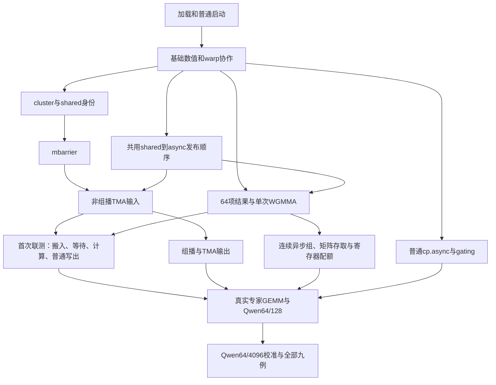

# Hopper PTX 支持实施概览

更新：2026-11-07。范围：冻结的九个单卡 MoE 用例。当前只完成调查和方案，未修改模拟器、构建或运行模拟验收。

## 要解决的问题与推进办法

PTX 模式必须自己计算结果、地址和分支，并模拟搬运/计算何时完成。已有 Hopper SASS 轨迹支持和 H100 配置可复用部分时间模型，但不等于冻结程序已经能执行 PTX。

先打通加载与普通启动，用转换、路由和重排验证基础执行，再用普通 cp.async 跑 gating GEMM。专家 GEMM 沿两条开发依赖线推进：阶段 3～5 负责两个 CTA 协作、搬运和通知，阶段 6 负责矩阵计算、完整寄存器结果与异步依赖。同一个专家内核同时使用两类能力；这不是运行时分支，也不要求按阶段编号串行开发。

**本轮调整：**非组播 TMA 输入、mbarrier 和单次 WGMMA 分别通过后，立即做“搬入→等待→计算→普通写出”的首次联测，不等组播、TMA 输出和寄存器配额全部完成。从首个真实普通内核开始记录初始化/模拟墙钟及 RSS；有代表性尺寸的专家调用一旦可用就更新九例运行预算，不留到最终集成结束。

实现细节见[分阶段计划](plans/README.md)，测试和结果记录见[分阶段验收](validation/README.md)。本文件只维护能力依赖和交付概览；[验证概览](hopper-validation.md)保留九例性能口径和基线，[决定文档](hopper-planning-decisions.md)保存已确认取舍，[调查依据](hopper-notes.md)保存事实与202条指令总映射。

## 开发依赖与首次联测

九个 gating 使用普通 cp.async 和 FP32 FMA；cluster、TMA、WGMMA 集中在共用专家模块，每例调用两次完成 FC1/FC2。WGMMA 小测试用普通 shared 准备输入，不依赖 TMA 或 ldmatrix 先完成。

shared 是 CTA 的共享存储，CTA 就是线程块。cluster 让两个 CTA 协作；mbarrier 同时等参与者到达和搬运字节完成。TMA 按 tensor map 描述搬矩阵；WGMMA 是128线程协作的异步矩阵计算。术语例子见[QA](hopper-qa.md)。

共用的指令发射/等待/完成代码由集成负责人统一维护；两线分别交付小功能并及时集成，不各自重写共用状态。首次联测的唯一测试说明在[阶段5验收](validation/stage-5.md#early-integration)，阶段6引用同一报告。

## 当前已核实缺口与影响

以下是静态核查或环境证据，不是当前 PTX workload 已复现故障。完整源码依据在[调查笔记](hopper-notes.md#current-gaps)，具体处理和后续风险在各阶段文档。

| 当前事实 | 为什么影响目标 | 归属 |
| --- | --- | --- |
| sm_90a 后缀未完整保留；参数对齐检查上限16B，实际有64B参数与新外部声明 | 模块无法按实际目标/参数布局进入执行 | 阶段0 |
| 直接launch配置栈来源不完整；动态shared未传完整，opt-in忽略 | 启动参数、分配空间和驻留数不能按实际launch处理 | 阶段0 |
| lanemask_le缺取值；SHFL时序解析六项但配置五项 | 基础线程协作缺语义，shuffle时间参数不完整 | 阶段1 |
| generic地址仍按96KiB/80SM；ExC未导出 | 当前大shared、132SM和两CTA启动不能沿旧范围直接使用 | 阶段3 |
| driver-entry未导出；本机真实编码探针无GPU | 冻结启动器无法完成前向前的tensor map准备 | 阶段5 |
| 多处结果容量8/32项；PTX未自动启用外层GMMA资源 | 64项结果和相应计算时间通路需要贯穿补齐 | 阶段6 |

多模块默认名称/共享表只是待测试线索，不是“只保留最后一个模块”的证据。普通 cp.async、cluster、mbarrier、TMA 和 WGMMA 所需 PTX 语义属于新增能力。

## 分阶段交付

### 阶段 0：加载、参数与普通启动

接通目标名、64B参数、直接launch、动态shared和测试入口；两模块交替启动验证归属，有证据才局部修正模块系统。冻结启动器先编码tensor map再注册110模块，早期使用独立/单模块测试，不声称完整程序已跑某个前缀。

[详细实现](plans/stage-0.md) · [验收](validation/stage-0.md)

### 阶段 1：基础数值与 warp 协作

补BF16、显式mask集合操作、redux/elect/lanemask等，尽早运行真实转换、路由、计数/重排。已有指令随消费者回归，不为154种旧写法各建单测；首个真实内核记录墙钟/RSS。

[详细实现](plans/stage-1.md) · [验收](validation/stage-1.md)

### 阶段 2：普通 cp.async 与 gating

复用LDGSTS请求/返回，补真实shared数据、零填和本线程组；验证wait6/0及搬运计算重叠。运行Mixtral/128与Qwen64/128代表gating，条件可比时对照时间和流量。

[详细实现](plans/stage-2.md) · [验收](validation/stage-2.md)

### 阶段 3：cluster、shared 身份与资源

实现ExC、CTA身份、mapa、cluster屏障和大地址范围，按资源保证两个CTA共同推进。当前每CTA动态shared215040B、每SM233472B，两CTA需跨SM；总分配216064B中的1024B是驱动保留，不是PTX静态shared。只做当前两CTA所需模型。

[详细实现](plans/stage-3.md) · [验收](validation/stage-3.md)

### 阶段 4：mbarrier 到达、字节与 phase

复用一份屏障状态，接通PTX求值、到达/有符号字节计数、phase和真假轮询。先用组件完成接口验非零计数，阶段5再用实际TMA返回重验；不提前声称搬运已通过。

[详细实现](plans/stage-4.md) · [验收](validation/stage-4.md)

### 阶段 5：tensor map、TMA 输入、组播与输出

使用模拟器128B内部对象，主机编码、设备replace/复制/发布与TMA共用。非组播输入通过就参加首次联测，再补两CTA组播和输出。区分输入交付、输出源读完、global写确认，实际wait1/0不能省略。

[详细实现](plans/stage-5.md) · [验收](validation/stage-5.md)

### 阶段 6：完整结果、矩阵布局与异步 WGMMA

64项结果贯穿解析、依赖、collector和写回；实现当前BF16/FP32矩阵及异步组、配额等待/归还。单次计算通过就参加首次联测，再验连续累加、wait1/0、setmaxnreg和完整双缓冲。沿用bank/端口，不扩精细物理重分配。

[详细实现](plans/stage-6.md) · [验收](validation/stage-6.md)

### 阶段 7：真实专家与九例

检查完整加载、FC1/FC2与最终前向，三类异步组不混、退出不漏写回。首个代表性真实专家就测墙钟/RSS并更新预算。顺序为Qwen64/128→Qwen64/4096→Phi/128、Mixtral/128→Phi/4096、Mixtral/4096→三个8192用例。

数值按现有compare.py；初期时间比较九例ncu的kernel和及主要调用，三个4096用nsys交叉检查。约20%不放宽数值，不用主机间隙/DMA缺项调整指令时间。主要机制合理、九例通过且时间接近目标后停止精调。

[详细实现](plans/stage-7.md) · [验收](validation/stage-7.md)

## 问题、暂缓与下一步

问题归入所属阶段：简短说明事实/触发条件、后果、实现位置和验收方法；跨阶段只维护一处并链接。不另建重复问题目录。低影响且繁琐的细节写进阶段暂缓表，出现当前消费者或主要误差证据再重开；数值、地址、同步和明显时间错误不能暂缓。

后续执行从阶段0开始。本轮仍只修改规划，不启动模拟器实现。详见[执行约定](plans/README.md)与[验收记录规则](validation/README.md)。
