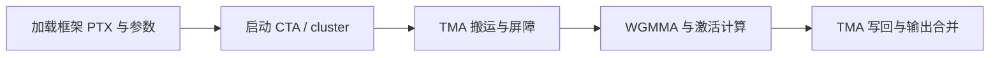

# 除指令以外，还需要实现什么

**对于当前冻结的九个单卡用例，本文件与[指令清单](ptx-instructions.md)就是模拟器的实现范围。**完成列出的功能、同步、访存顺序及时间模型后，就可以按 [README](../README.md#实现完成后如何模拟) 启动，并使用已有 H100 结果检查输出与耗时。

| 必须接通的部分 | 缺少会怎样 | 当前需要的范围 |
| --- | --- | --- |
| **寄存器与数据依赖** | 只写回 WGMMA 的前几个结果会算错；每次发起便等待全部结果会把重叠算没 | `m64n128k16` 每线程有 64 个 FP32 累加寄存器。IR 元组、decode、scoreboard、collector、写回和统计都需覆盖；现有部分容量只有 8/32。连续异步累加依赖应按 WGMMA 组和完成等待处理 |
| **PTX 加载与语法** | CUDA 程序尚未进入 MoE 就退出，或选错目标代码 | 保留 `sm_90a` 的 a 后缀；正确加载二进制内多个 fatbinary/PTX 模块及唯一 entry。接受实际出现的参数对齐、`.noreturn` 外部 `__assertfail` 声明；不用实现整个 PTX 8.7。PTX 8.8 来源模块只将 header 降至 8.7，已经逐模块通过 CUDA 12.8 ptxas 检查 |
| **主机启动与 tensor map** | 不能取得 TMA 编码函数、不能启动两个 CTA 的 cluster，或错误分配共享内存 | 补 `cudaGetDriverEntryPointByVersion`、`cudaLaunchKernelExC`；正确处理 `cudaFuncSetAttribute`、每次 launch 的动态 shared 字节数和 cluster 属性。TE GEMM 当前为 384 线程/CTA、215040 字节动态 shared。按真实参数生成、传递并解释 tensor map；可复用 NVIDIA 编码函数，不要求重写编码算法 |
| **cluster、特殊寄存器与异步完成** | CTA 可能读到旧 tile、写回尚未读取便复用 shared，或相互等待而无法前进 | 当前 cluster 是同卡 **1×2×1、两个 CTA**。保留各 CTA 的 cluster 坐标/rank 和 shared 映射，连接 TMA、mbarrier 与 cluster 同步；让两个 CTA 都能推进。`%lanemask_le` 当前只有语法入口，取值仍未实现。普通 cp.async、bulk/TMA 与 WGMMA 的异步组分别维护 |

[动态符号核查](../evidence/runtime-interface-audit.json)记录当前二进制需要的接口和模拟库导出情况。`__cudaRegisterFatBinaryEnd` 等接口已有导出；**导出存在不代表语义或耗时已验收。**

## 这个独立程序执行哪些内容

[启动程序](../source/launcher.cu)重新分配缓冲区、初始化输入/权重、重编码 tensor map，再按框架实际顺序启动来自框架的 GPU 内核并执行必要的内存复制。最终输出从设备下载。它适用于已经固定的模型、token 数、seed 和路由；修改这些条件需要重新导出。前向中由主机根据专家计数准备的启动元数据已固定在 `forward.bin`，不是通用 PyTorch 运行时。

所有矩阵乘法、top-k、重排、激活和加权合并仍由设备代码执行。模拟器必须执行对应 PTX 并生成结果。CUPTI 和 PyTorch 只用于导出阶段，独立执行不需要它们。二进制同时带有 GPU 原生代码供 H100 验证；SASS 轨迹模式已有支持不能证明这里的 PTX 执行路径已经支持。

## 执行与对比

完整启动命令和输出位置见 [README](../README.md#实现完成后如何模拟)。参考数据已经覆盖全部九个用例，无需重新租卡。`compare.py` 对比完整输出，并核对二进制、输入以及一次无预热前向的条件。

真实 GPU 的 CUDA event 区间包含启动间隙和必要的主机同步；模拟器的区间来自累计设备周期。若主机间隙未建模，不能把二者的差额全部归因于 GPU 指令时序。应结合内核/访存统计校准，框架整层耗时另见[性能说明](performance.md)。

源码核查入口：[PTX 执行](../../../gpu-simulator/gpgpu-sim/src/cuda-sim/)、[CUDA 主机库](../../../gpu-simulator/gpgpu-sim/libcuda/)、[周期模型](../../../gpu-simulator/gpgpu-sim/src/gpgpu-sim/)。
