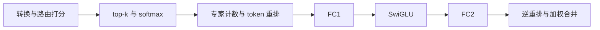

# 110 个 PTX 模块分别做什么

110 是九个用例所用 **PTX 编译模块的去重集合**；每份 PTX 含一个 kernel entry，全部都被使用。每次 MoE 前向只启动 22～24 个内核。Triton 会按矩阵尺寸、token 数及编译选择生成不同版本，所以同一个源码内核可能对应多份 PTX。

| 用途 | 去重模块数 |
| --- | ---: |
| 输入与路由权重类型转换 | 8 |
| 路由 gating GEMM | 9 |
| top-k 与排序 | 2 |
| softmax、稀疏路由及后处理转换 | 36 |
| 专家 token 数统计 | 15 |
| 构造 token 行映射 | 11 |
| 按专家重排 token | 6 |
| chunk 映射与重排 | 7 |
| 专家 FC1 / FC2 grouped GEMM | 1 |
| SwiGLU | 9 |
| 输出逆重排与加权合并 | 6 |
| **合计** | **110** |

**专家 FC1/FC2 只用模块 16：每次前向调用两次，矩阵尺寸由参数决定。**模块 3（top-k）、4（排序）、10（行映射第一步）、16 被全部九用例复用。chunk 映射与重排也各调用两次。

| 用例 | 前向启动次数 | 用到的去重模块数 |
| --- | ---: | ---: |
| mixtral-t128 | 22 | 19 |
| mixtral-t4096 | 23 | 20 |
| mixtral-t8192 | 23 | 20 |
| phi-t128 | 22 | 19 |
| phi-t4096 | 23 | 20 |
| phi-t8192 | 23 | 20 |
| qwen64-t128 | 22 | 19 |
| qwen64-t4096 | 24 | 21 |
| qwen64-t8192 | 24 | 21 |

大 token 用例多一步计数归约；部分转换会被融合，Qwen 路由后处理也有额外内核，因此启动数略有不同。以下编号沿用[工作负载清单](../artifacts/workloads.json)，范围是 0～109。

展开全部 110 个模块与文件的对应表

| 编号 | 用途 | PTX 文件 |
| ---: | --- | --- |
| 0 | 输入与路由权重类型转换 | [b65747af61585f3b.ptx](../artifacts/ptx/b65747af61585f3b.ptx) |
| 1 | 输入与路由权重类型转换 | [97544f6266334931.ptx](../artifacts/ptx/97544f6266334931.ptx) |
| 2 | 路由 gating GEMM | [cf685bb5cf3652b7.ptx](../artifacts/ptx/cf685bb5cf3652b7.ptx) |
| 3 | top-k 与排序 | [cd71bc5848a4af72.ptx](../artifacts/ptx/cd71bc5848a4af72.ptx) |
| 4 | top-k 与排序 | [7bd6f3b7131e7873.ptx](../artifacts/ptx/7bd6f3b7131e7873.ptx) |
| 5 | softmax、稀疏路由及后处理转换 | [faa9858a4443dd66.ptx](../artifacts/ptx/faa9858a4443dd66.ptx) |
| 6 | softmax、稀疏路由及后处理转换 | [a71bc546f8276179.ptx](../artifacts/ptx/a71bc546f8276179.ptx) |
| 7 | softmax、稀疏路由及后处理转换 | [cabbd061a6da98db.ptx](../artifacts/ptx/cabbd061a6da98db.ptx) |
| 8 | softmax、稀疏路由及后处理转换 | [d4ed9819894b1289.ptx](../artifacts/ptx/d4ed9819894b1289.ptx) |
| 9 | 专家 token 数统计 | [9707f921bf7e6a8e.ptx](../artifacts/ptx/9707f921bf7e6a8e.ptx) |
| 10 | 构造 token 行映射 | [cc04e1548eb39807.ptx](../artifacts/ptx/cc04e1548eb39807.ptx) |
| 11 | 构造 token 行映射 | [6e714b8cf7f7be2e.ptx](../artifacts/ptx/6e714b8cf7f7be2e.ptx) |
| 12 | 构造 token 行映射 | [756851cbac2894af.ptx](../artifacts/ptx/756851cbac2894af.ptx) |
| 13 | 按专家重排 token | [a13a77f7ed02cf24.ptx](../artifacts/ptx/a13a77f7ed02cf24.ptx) |
| 14 | chunk 映射与重排 | [23ba58950db8f4f0.ptx](../artifacts/ptx/23ba58950db8f4f0.ptx) |
| 15 | chunk 映射与重排 | [d4f74cd8054a8aac.ptx](../artifacts/ptx/d4f74cd8054a8aac.ptx) |
| 16 | 专家 FC1 / FC2 grouped GEMM | [df3e0c49e4650c1f.ptx](../artifacts/ptx/df3e0c49e4650c1f.ptx) |
| 17 | SwiGLU | [715b6dbe87249da2.ptx](../artifacts/ptx/715b6dbe87249da2.ptx) |
| 18 | 输出逆重排与加权合并 | [870767fb7effb148.ptx](../artifacts/ptx/870767fb7effb148.ptx) |
| 19 | 输入与路由权重类型转换 | [b74b5f15c8e2c3b4.ptx](../artifacts/ptx/b74b5f15c8e2c3b4.ptx) |
| 20 | 路由 gating GEMM | [a88b4a7815d52e51.ptx](../artifacts/ptx/a88b4a7815d52e51.ptx) |
| 21 | softmax、稀疏路由及后处理转换 | [86fe8f98bf3774eb.ptx](../artifacts/ptx/86fe8f98bf3774eb.ptx) |
| 22 | softmax、稀疏路由及后处理转换 | [d6c5f6a1190928fa.ptx](../artifacts/ptx/d6c5f6a1190928fa.ptx) |
| 23 | softmax、稀疏路由及后处理转换 | [122bb96c5c596523.ptx](../artifacts/ptx/122bb96c5c596523.ptx) |
| 24 | softmax、稀疏路由及后处理转换 | [e0d77c5d8dd6b50b.ptx](../artifacts/ptx/e0d77c5d8dd6b50b.ptx) |
| 25 | 专家 token 数统计 | [365e2dfde690bf4e.ptx](../artifacts/ptx/365e2dfde690bf4e.ptx) |
| 26 | 专家 token 数统计 | [cf534e147155fb1c.ptx](../artifacts/ptx/cf534e147155fb1c.ptx) |
| 27 | 构造 token 行映射 | [38835c0e85f7a649.ptx](../artifacts/ptx/38835c0e85f7a649.ptx) |
| 28 | SwiGLU | [8f707b8936157ea7.ptx](../artifacts/ptx/8f707b8936157ea7.ptx) |
| 29 | 输出逆重排与加权合并 | [7aa653c851148185.ptx](../artifacts/ptx/7aa653c851148185.ptx) |
| 30 | 输入与路由权重类型转换 | [0246c7163d0f0932.ptx](../artifacts/ptx/0246c7163d0f0932.ptx) |
| 31 | 路由 gating GEMM | [f6916e7b59292f21.ptx](../artifacts/ptx/f6916e7b59292f21.ptx) |
| 32 | softmax、稀疏路由及后处理转换 | [81ec60dd179020bc.ptx](../artifacts/ptx/81ec60dd179020bc.ptx) |
| 33 | softmax、稀疏路由及后处理转换 | [b49267d4e7cce730.ptx](../artifacts/ptx/b49267d4e7cce730.ptx) |
| 34 | softmax、稀疏路由及后处理转换 | [1d77cfc1699759be.ptx](../artifacts/ptx/1d77cfc1699759be.ptx) |
| 35 | softmax、稀疏路由及后处理转换 | [da5dec86fbcc324f.ptx](../artifacts/ptx/da5dec86fbcc324f.ptx) |
| 36 | 专家 token 数统计 | [1091be054bcfc4d8.ptx](../artifacts/ptx/1091be054bcfc4d8.ptx) |
| 37 | 专家 token 数统计 | [874e4acc280128b7.ptx](../artifacts/ptx/874e4acc280128b7.ptx) |
| 38 | 构造 token 行映射 | [8c94e68c337bf6e4.ptx](../artifacts/ptx/8c94e68c337bf6e4.ptx) |
| 39 | SwiGLU | [f033468fc6f9ac55.ptx](../artifacts/ptx/f033468fc6f9ac55.ptx) |
| 40 | 输入与路由权重类型转换 | [eda9752c30f985cb.ptx](../artifacts/ptx/eda9752c30f985cb.ptx) |
| 41 | 路由 gating GEMM | [59145fe90344eeb3.ptx](../artifacts/ptx/59145fe90344eeb3.ptx) |
| 42 | softmax、稀疏路由及后处理转换 | [d567ba21db35de3a.ptx](../artifacts/ptx/d567ba21db35de3a.ptx) |
| 43 | softmax、稀疏路由及后处理转换 | [70c142261dbf7d42.ptx](../artifacts/ptx/70c142261dbf7d42.ptx) |
| 44 | softmax、稀疏路由及后处理转换 | [5564ce3faa31bd81.ptx](../artifacts/ptx/5564ce3faa31bd81.ptx) |
| 45 | softmax、稀疏路由及后处理转换 | [b772016a040a6f6a.ptx](../artifacts/ptx/b772016a040a6f6a.ptx) |
| 46 | 专家 token 数统计 | [8ebc07636f7016e4.ptx](../artifacts/ptx/8ebc07636f7016e4.ptx) |
| 47 | 构造 token 行映射 | [d497513641746c2a.ptx](../artifacts/ptx/d497513641746c2a.ptx) |
| 48 | 构造 token 行映射 | [7b049f3a13e0c926.ptx](../artifacts/ptx/7b049f3a13e0c926.ptx) |
| 49 | 按专家重排 token | [f8a47d09b6c07489.ptx](../artifacts/ptx/f8a47d09b6c07489.ptx) |
| 50 | chunk 映射与重排 | [f382d362fada1d9b.ptx](../artifacts/ptx/f382d362fada1d9b.ptx) |
| 51 | chunk 映射与重排 | [829bbe4de5f449bd.ptx](../artifacts/ptx/829bbe4de5f449bd.ptx) |
| 52 | SwiGLU | [c08a7242ae5027f5.ptx](../artifacts/ptx/c08a7242ae5027f5.ptx) |
| 53 | 输出逆重排与加权合并 | [9dcc01672ee692a2.ptx](../artifacts/ptx/9dcc01672ee692a2.ptx) |
| 54 | 路由 gating GEMM | [d617e177b975d79c.ptx](../artifacts/ptx/d617e177b975d79c.ptx) |
| 55 | softmax、稀疏路由及后处理转换 | [36e18b6fa2ea8266.ptx](../artifacts/ptx/36e18b6fa2ea8266.ptx) |
| 56 | 专家 token 数统计 | [43a057fefc3e1288.ptx](../artifacts/ptx/43a057fefc3e1288.ptx) |
| 57 | 专家 token 数统计 | [e5ec00622ee3fc0f.ptx](../artifacts/ptx/e5ec00622ee3fc0f.ptx) |
| 58 | 按专家重排 token | [1fe01d4c3326bbed.ptx](../artifacts/ptx/1fe01d4c3326bbed.ptx) |
| 59 | SwiGLU | [080eab9246a9e166.ptx](../artifacts/ptx/080eab9246a9e166.ptx) |
| 60 | 输出逆重排与加权合并 | [cf0a99e09ad4ce9f.ptx](../artifacts/ptx/cf0a99e09ad4ce9f.ptx) |
| 61 | 路由 gating GEMM | [ef7e959540882802.ptx](../artifacts/ptx/ef7e959540882802.ptx) |
| 62 | softmax、稀疏路由及后处理转换 | [91044d15084671ab.ptx](../artifacts/ptx/91044d15084671ab.ptx) |
| 63 | softmax、稀疏路由及后处理转换 | [dd01ab1b60f96f5e.ptx](../artifacts/ptx/dd01ab1b60f96f5e.ptx) |
| 64 | softmax、稀疏路由及后处理转换 | [0f77e1c592ff33ce.ptx](../artifacts/ptx/0f77e1c592ff33ce.ptx) |
| 65 | softmax、稀疏路由及后处理转换 | [2c7e9cf01a701169.ptx](../artifacts/ptx/2c7e9cf01a701169.ptx) |
| 66 | 专家 token 数统计 | [5ee83ea169c92aec.ptx](../artifacts/ptx/5ee83ea169c92aec.ptx) |
| 67 | 专家 token 数统计 | [c3a4de14a1cad51c.ptx](../artifacts/ptx/c3a4de14a1cad51c.ptx) |
| 68 | 构造 token 行映射 | [c3a2dd5f1d7cde5d.ptx](../artifacts/ptx/c3a2dd5f1d7cde5d.ptx) |
| 69 | SwiGLU | [3d425d5a3ff8b88f.ptx](../artifacts/ptx/3d425d5a3ff8b88f.ptx) |
| 70 | 输入与路由权重类型转换 | [9ca2fcdc351fed1c.ptx](../artifacts/ptx/9ca2fcdc351fed1c.ptx) |
| 71 | 路由 gating GEMM | [b4d06c15353157e5.ptx](../artifacts/ptx/b4d06c15353157e5.ptx) |
| 72 | softmax、稀疏路由及后处理转换 | [f505cf4dd5edb105.ptx](../artifacts/ptx/f505cf4dd5edb105.ptx) |
| 73 | softmax、稀疏路由及后处理转换 | [0c94b6d8d3481a80.ptx](../artifacts/ptx/0c94b6d8d3481a80.ptx) |
| 74 | softmax、稀疏路由及后处理转换 | [cfb8d989042ba5df.ptx](../artifacts/ptx/cfb8d989042ba5df.ptx) |
| 75 | softmax、稀疏路由及后处理转换 | [45ff4fce81e9bcc8.ptx](../artifacts/ptx/45ff4fce81e9bcc8.ptx) |
| 76 | softmax、稀疏路由及后处理转换 | [6783f479ece78566.ptx](../artifacts/ptx/6783f479ece78566.ptx) |
| 77 | 专家 token 数统计 | [01074d70bb53382e.ptx](../artifacts/ptx/01074d70bb53382e.ptx) |
| 78 | 构造 token 行映射 | [cab47fdb58edf01c.ptx](../artifacts/ptx/cab47fdb58edf01c.ptx) |
| 79 | 按专家重排 token | [335c53a52dd0b014.ptx](../artifacts/ptx/335c53a52dd0b014.ptx) |
| 80 | chunk 映射与重排 | [c479f139e809aa8b.ptx](../artifacts/ptx/c479f139e809aa8b.ptx) |
| 81 | chunk 映射与重排 | [e9d85ad3f42fd8b0.ptx](../artifacts/ptx/e9d85ad3f42fd8b0.ptx) |
| 82 | SwiGLU | [69a51306a3621854.ptx](../artifacts/ptx/69a51306a3621854.ptx) |
| 83 | 输出逆重排与加权合并 | [4d78f60e03b223a2.ptx](../artifacts/ptx/4d78f60e03b223a2.ptx) |
| 84 | 输入与路由权重类型转换 | [896ef1b80766f39a.ptx](../artifacts/ptx/896ef1b80766f39a.ptx) |
| 85 | 输入与路由权重类型转换 | [69cc84de97944264.ptx](../artifacts/ptx/69cc84de97944264.ptx) |
| 86 | 路由 gating GEMM | [838c032a7a88e7a0.ptx](../artifacts/ptx/838c032a7a88e7a0.ptx) |
| 87 | softmax、稀疏路由及后处理转换 | [4dd08421cbd97ede.ptx](../artifacts/ptx/4dd08421cbd97ede.ptx) |
| 88 | softmax、稀疏路由及后处理转换 | [53665f02e8884b48.ptx](../artifacts/ptx/53665f02e8884b48.ptx) |
| 89 | softmax、稀疏路由及后处理转换 | [1775a8b46491e582.ptx](../artifacts/ptx/1775a8b46491e582.ptx) |
| 90 | softmax、稀疏路由及后处理转换 | [3e060b250c9c0eaa.ptx](../artifacts/ptx/3e060b250c9c0eaa.ptx) |
| 91 | softmax、稀疏路由及后处理转换 | [0d3fa1d540e73560.ptx](../artifacts/ptx/0d3fa1d540e73560.ptx) |
| 92 | 专家 token 数统计 | [fccfe921542d9ceb.ptx](../artifacts/ptx/fccfe921542d9ceb.ptx) |
| 93 | 专家 token 数统计 | [c77767d694ecf2ec.ptx](../artifacts/ptx/c77767d694ecf2ec.ptx) |
| 94 | 构造 token 行映射 | [1fcdae4b81ca74a4.ptx](../artifacts/ptx/1fcdae4b81ca74a4.ptx) |
| 95 | 按专家重排 token | [25a9e0b60fb37228.ptx](../artifacts/ptx/25a9e0b60fb37228.ptx) |
| 96 | chunk 映射与重排 | [6111d03e4948ce2e.ptx](../artifacts/ptx/6111d03e4948ce2e.ptx) |
| 97 | SwiGLU | [8f7985f0f37e7b00.ptx](../artifacts/ptx/8f7985f0f37e7b00.ptx) |
| 98 | 输出逆重排与加权合并 | [ac10839130b06565.ptx](../artifacts/ptx/ac10839130b06565.ptx) |
| 99 | 路由 gating GEMM | [4ebef89fddede208.ptx](../artifacts/ptx/4ebef89fddede208.ptx) |
| 100 | softmax、稀疏路由及后处理转换 | [bfebfa6c25a1e9b9.ptx](../artifacts/ptx/bfebfa6c25a1e9b9.ptx) |
| 101 | softmax、稀疏路由及后处理转换 | [8c3498e8360725be.ptx](../artifacts/ptx/8c3498e8360725be.ptx) |
| 102 | softmax、稀疏路由及后处理转换 | [05c23589eb90845d.ptx](../artifacts/ptx/05c23589eb90845d.ptx) |
| 103 | softmax、稀疏路由及后处理转换 | [13feaf4f46a3800d.ptx](../artifacts/ptx/13feaf4f46a3800d.ptx) |
| 104 | softmax、稀疏路由及后处理转换 | [36846f3678feb0f8.ptx](../artifacts/ptx/36846f3678feb0f8.ptx) |
| 105 | 专家 token 数统计 | [7327fa5c20c77d3a.ptx](../artifacts/ptx/7327fa5c20c77d3a.ptx) |
| 106 | 专家 token 数统计 | [647c5fa6ac891eff.ptx](../artifacts/ptx/647c5fa6ac891eff.ptx) |
| 107 | 构造 token 行映射 | [cdf2077a76c3d46b.ptx](../artifacts/ptx/cdf2077a76c3d46b.ptx) |
| 108 | 按专家重排 token | [f0f55f7bdb6f17b7.ptx](../artifacts/ptx/f0f55f7bdb6f17b7.ptx) |
| 109 | SwiGLU | [9cb3c7771ae8423a.ptx](../artifacts/ptx/9cb3c7771ae8423a.ptx) |

展开九个用例的实际调用顺序

**mixtral-t128**

`0 → 1 → 2 → 3 → 4 → 5 → 6 → 7 → 8 → 9 → 10 → 11 → 12 → 13 → 14 → 15 → 16 → 17 → 16 → 14 → 15 → 18`

**mixtral-t4096**

`19 → 1 → 20 → 3 → 4 → 21 → 22 → 23 → 24 → 25 → 26 → 10 → 27 → 12 → 13 → 14 → 15 → 16 → 28 → 16 → 14 → 15 → 29`

**mixtral-t8192**

`30 → 1 → 31 → 3 → 4 → 32 → 33 → 34 → 35 → 36 → 37 → 10 → 38 → 12 → 13 → 14 → 15 → 16 → 39 → 16 → 14 → 15 → 29`

**phi-t128**

`0 → 40 → 41 → 3 → 4 → 42 → 43 → 44 → 45 → 46 → 10 → 47 → 48 → 49 → 50 → 51 → 16 → 52 → 16 → 50 → 51 → 53`

**phi-t4096**

`19 → 40 → 54 → 3 → 4 → 32 → 33 → 55 → 35 → 56 → 57 → 10 → 38 → 48 → 58 → 50 → 15 → 16 → 59 → 16 → 50 → 15 → 60`

**phi-t8192**

`30 → 40 → 61 → 3 → 4 → 62 → 63 → 64 → 65 → 66 → 67 → 10 → 68 → 48 → 58 → 50 → 15 → 16 → 69 → 16 → 50 → 15 → 60`

**qwen64-t128**

`70 → 71 → 3 → 4 → 72 → 73 → 74 → 75 → 76 → 77 → 10 → 38 → 78 → 79 → 80 → 81 → 16 → 82 → 16 → 80 → 81 → 83`

**qwen64-t4096**

`84 → 85 → 86 → 3 → 4 → 87 → 88 → 89 → 90 → 91 → 92 → 93 → 10 → 94 → 78 → 95 → 80 → 96 → 16 → 97 → 16 → 80 → 96 → 98`

**qwen64-t8192**

`19 → 85 → 99 → 3 → 4 → 100 → 101 → 102 → 103 → 104 → 105 → 106 → 10 → 107 → 78 → 108 → 80 → 96 → 16 → 109 → 16 → 80 → 96 → 98`

这些用例共用一个[启动程序](../source/launcher.cu)，由 `forward.bin` 选择实际启动参数与顺序。完整入口见 [README](../README.md)。
